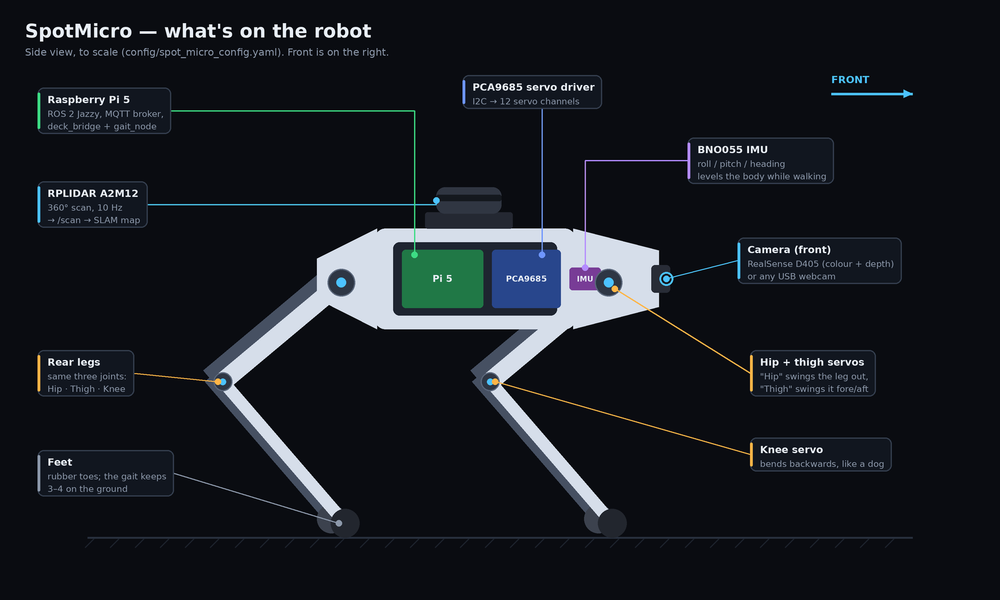
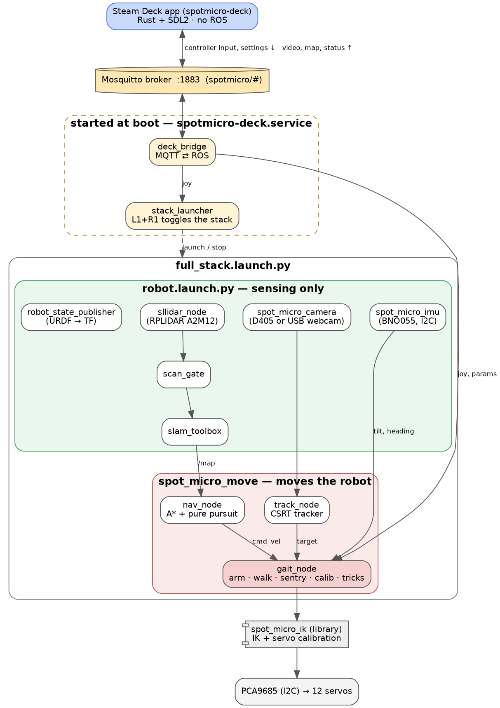
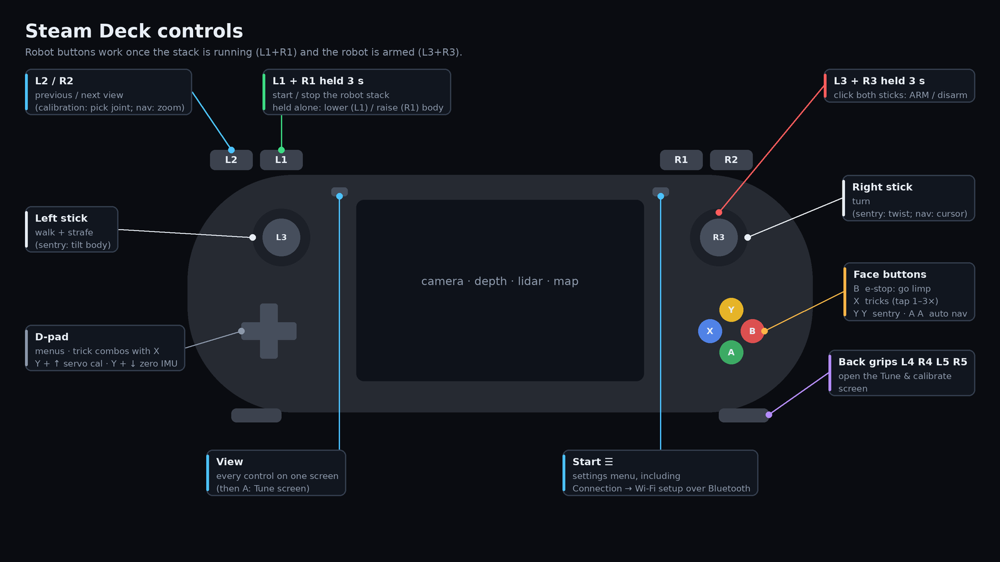

# SpotMicroROS2

A SpotMicro quadruped on a **Raspberry Pi 5** running **ROS 2 Jazzy**, driven from a
**Steam Deck**. The robot maps its surroundings with a lidar (SLAM), walks with an IMU-stabilised
crawl gait, and can plan and walk a path to a goal you pick on the Deck's map.

📖 **Full documentation is in the [wiki](https://github.com/Coldport/SpotMicroROS2/wiki).**





## Hardware

| Part | Used for |
|---|---|
| Raspberry Pi 5 | runs everything (ROS 2 Jazzy) |
| PCA9685 + 12 servos | legs, through `spot_micro_ik` |
| RPLIDAR A2M12 | `/scan` → slam_toolbox |
| Adafruit BNO055 (I2C) | leveling, walking stabilisation, heading |
| RealSense D405 *or* a USB webcam | camera (and depth on the D405) |
| Steam Deck | controller and display (native Rust + SDL2 app, talks MQTT) |

## Quick start

```bash
./setup.sh                                # deps, udev rules, Mosquitto, systemd services
source /opt/ros/jazzy/setup.bash
colcon build
source install/setup.bash

ros2 launch spot_micro_bringup robot.launch.py        # sensing + SLAM only, never moves
```

From the Steam Deck ([install the app](https://github.com/Coldport/SpotMicroROS2/wiki/Installing-the-Deck-App)):

1. The robot starts the Deck bridge on boot. Open the app and it connects.
2. Hold **L1 + R1** for 3 s to start the stack (sensors, SLAM, and the gait node, disarmed).
3. Hold **L3 + R3** for 3 s to **arm**. The sticks now walk the robot. **B** makes it go limp.



> ⚠️ `gait_node` drives real servos, and the MQTT broker accepts anonymous clients by default.
> [Enable a broker password](https://github.com/Coldport/SpotMicroROS2/wiki/Steam-Deck-App#security)
> on any network you don't fully trust.

## Packages

| Path | What it is |
|---|---|
| `src/spot_micro_bringup` | `robot.launch.py`: lidar, IMU, camera, URDF, SLAM |
| `src/spot_micro_move` | `gait_node` (walk / sentry / calibration / tricks), `nav_node` (A* auto nav), `track_node` |
| `src/spot_micro_deck` | `deck_bridge` (MQTT ⇄ ROS), `stack_launcher`, Bluetooth Wi-Fi provisioning |
| `src/spot_micro_imu` | BNO055 driver |
| `src/spot_micro_camera` | auto-detects the D405 or a USB webcam |
| `src/sllidar_ros2` | Slamtec lidar driver (vendored) |
| `spot_micro_ik/` | standalone IK and servo calibration library |
| `steamdeck_app/` | Steam Deck app (`deploy.sh` cross-builds and installs it) |

## Documentation

| | |
|---|---|
| [Setup](https://github.com/Coldport/SpotMicroROS2/wiki/Setup) | `setup.sh`, building, X11 forwarding for GUI scripts |
| [Bringup and SLAM](https://github.com/Coldport/SpotMicroROS2/wiki/Bringup-and-SLAM) | launch files, TF tree, odometry, maps |
| [LiDAR](https://github.com/Coldport/SpotMicroROS2/wiki/LiDAR) · [Camera](https://github.com/Coldport/SpotMicroROS2/wiki/Camera) · [IMU](https://github.com/Coldport/SpotMicroROS2/wiki/IMU) | drivers, topics, wiring, calibration |
| [Viewing with Foxglove](https://github.com/Coldport/SpotMicroROS2/wiki/Viewing-with-Foxglove) | scan, camera, IMU and map in a browser |
| [Steam Deck App](https://github.com/Coldport/SpotMicroROS2/wiki/Steam-Deck-App) | settings, boot service, installing, Wi-Fi over Bluetooth |
| [Deck Controls](https://github.com/Coldport/SpotMicroROS2/wiki/Deck-Controls) | every button, plus the `/spotmicro_deck/joy` mapping |
| [Robot Modes](https://github.com/Coldport/SpotMicroROS2/wiki/Robot-Modes) | arming, walk, sentry and tracking, servo calibration, tricks |
| [Maps and Auto Nav](https://github.com/Coldport/SpotMicroROS2/wiki/Maps-and-Auto-Nav) | saving and loading maps, walking to a goal |
| [Troubleshooting](https://github.com/Coldport/SpotMicroROS2/wiki/Troubleshooting) | known errors and fixes |
| [Testing Status](https://github.com/Coldport/SpotMicroROS2/wiki/Testing-Status) | what has been verified on real hardware |

## License

See [LICENSE](LICENSE). Leg geometry is from [mike4192/spotMicro](https://github.com/mike4192/spotMicro) (MIT).
